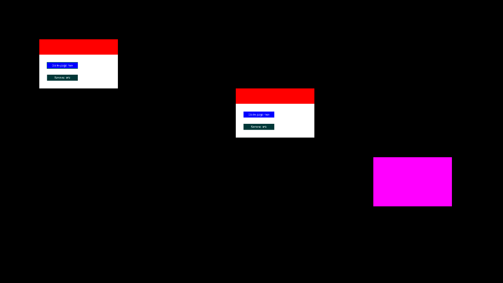

# Trying browser.folk on a real Folk system

`builtin-programs/browser/` renders live web pages onto pages:

    Wish $this renders https://example.com in a browser
    Wish $this renders https://example.com in a browser below
    Wish $this browser is tilt-sensitive
    Wish $this plays YouTube video "dQw4w9WgXcQ"
    When /target/ is a link { Wish $this renders $target in a browser }

Everything here has been exercised in simulation (software Vulkan +
headless Chromium, see "Simulation" below) but **not yet on a table**.
This is the checklist for the first real run.

## 1. Setup (once per machine)

Nothing to install by hand. The first time a page asks for a browser,
`browser-setup.folk` looks for Chromium in this order and uses the
first it finds:

1. `$FOLK_BROWSER_CHROMIUM` (set it in `folk.service` or the shell if
   you want a specific binary);
2. Playwright's own Chromium under `$PLAYWRIGHT_BROWSERS_PATH` or
   `~/.cache/ms-playwright`;
3. a system `chromium` / `chromium-browser` / `google-chrome`.

If none exists it runs `uvx --with playwright==1.56.0 playwright
install chromium` itself (~150 MB, a few minutes on a Pi) and shows
**"Installing browser (first run, ~150 MB)..."** on the page meanwhile.

The one thing that *can* need root is Chromium's system libraries. If
the page shows **"Chromium is missing system libraries"**, run the
command it prints:

    sudo uvx --with playwright==1.56.0 playwright install-deps chromium

(or `sudo apt install chromium` and let Folk pick the system one.)

Prerequisites that Folk already needs: `uvx` (uv) on the PATH of the
user Folk runs as, and outbound network for the first install.

## 2. Smoke test, no camera needed

Before printing anything, run the tests on the Folk machine itself.
They use a software Vulkan driver when present and never touch the
projector:

    sudo apt install mesa-vulkan-drivers   # lavapipe, for the GPU tests
    test/run-browser-tests.sh              # all test/browser-*.folk
    ./folk test/gpu-offscreen.folk         # GPU stack, offscreen

`run-browser-tests.sh` fails if a test leaves files or processes
behind or if Folk had to kill a slow rule. `FOLK_TEST_NETWORK=1
test/run-browser-tests.sh` also runs the real Chromium download test.
Set `FOLK_SNAPSHOT_DIR=/some/dir` to keep the simulation's PNGs.

## 3. On the table

Print these pages (`Notify: print code {...}` from the editor, or
write them as `user-programs/<host>/*.folk`):

**Browser page**

    Wish $this renders https://already-clean.goodfire.com/#:~:text=The%20bad%20news,the%20first%20place in a browser
    Wish $this browser is tilt-sensitive

**Pointer** (any page that points at the browser page)

    Wish $this points up with length 2

**Viewer** (opens whatever link is being pointed at)

    When /target/ is a link { Wish $this renders $target in a browser }

**YouTube binder** (prints one page per video)

    Notify: print a YouTube binder with videos {
        {dQw4w9WgXcQ "Never Gonna Give You Up"}
        {jNQXAC9IVRw "Me at the zoo"}
    }

Then check, in this order, and note what you see:

| # | Check | Expect |
|---|-------|--------|
| 1 | Put the browser page down | Page renders on the paper within ~5 s (first ever run: "Installing browser..." first). Text readable at arm's length. |
| 2 | Scroll-to-text fragment | The quoted sentence is highlighted yellow and scrolled into view. |
| 3 | Move the paper | The page follows; no visible lag beyond the usual projector latency. |
| 4 | Tilt: raise the **top** edge ~20° | Page scrolls **up**; stops when flat again. |
| 5 | Tilt: raise the **bottom** edge | Page scrolls **down**. If 4/5 are reversed, add `with inverted true` and report it (see "Tilt sign" below). |
| 6 | Leave the page flat but at an angle on the table | It must **not** creep. If it does, the rest normal is wrong: report the camera/table geometry. |
| 7 | Point the pointer's whisker at a link | The link gets a green outline that fills left to right over ~1 s. |
| 8 | Hold still for 1 s | The browser follows the link. |
| 9 | Pointer + viewer | The viewer page shows the hovered link's page while the pointer is on it. |
| 10 | Jitter the pointer slightly on one link | Outline stays; no flicker between neighbouring links; the viewer does not reload. |
| 11 | `in a browser below` / `above` / `leftward` / `rightward` | A same-size browser appears next to the page. |
| 12 | YouTube binder page | Video plays (muted). Note the frame rate and whether the embed shows "Video unavailable". |
| 13 | Take the page away | Chromium's CPU use drops (`top`); `ps` shows no new `chrome` processes piling up. |

Watch `journalctl -u folk -f` (or the per-program files under
`/var/tmp/folk-<pid>/`) for lines starting with `browser:` or `KILL (`.

### Tilt sign

`browser-lib.folk`'s `tiltDegrees` assumes the page's normal is
`cross(right edge, down edge)`, pointing away from the camera (the
OpenCV convention Folk's tag poses use), and takes the page's first
sighting as "flat". Two things to verify on hardware:

- raising the top edge gives a positive angle (scrolls up);
- a page lying flat anywhere on the table reads ~0°, not just where it
  was first seen.

If either is wrong, record a few seconds of `$page has quad` claims
for the positions in the table above (flat in several places, top
raised, bottom raised) and keep the recording: `docs/browser-plan.md`
describes the replay test to build from it.

## 4. Known limitations

- The frame rate on a page is limited to 15 fps and only changes when
  the page repaints; video will look choppy on slower machines.
- YouTube is muted (Chromium's autoplay policy); sound is untested.
- Folk's image pipeline decodes images as sRGB → linear and writes
  that to the display, so mid-tone colours come out darker than in a
  normal browser. Pure colours are unaffected. This is how all images
  in Folk currently render, not specific to the browser.
- Very occasionally (about 1 frame in 800 in simulation) a page's
  canvas is blank for one frame when a new browser frame replaces the
  old one.

## Simulation

`test/browser-sim.folk` runs the real GPU stack on lavapipe with
draw.folk's "offscreen" display, real Chromium, and browser.folk, and
reads the simulated table back. `docs/images/browser-sim.png` is one
of its frames: the browser page (top left) with the pointer hovering
the first link, the same page's `below` browser (middle), and the
viewer page showing the hovered link (magenta, right).

