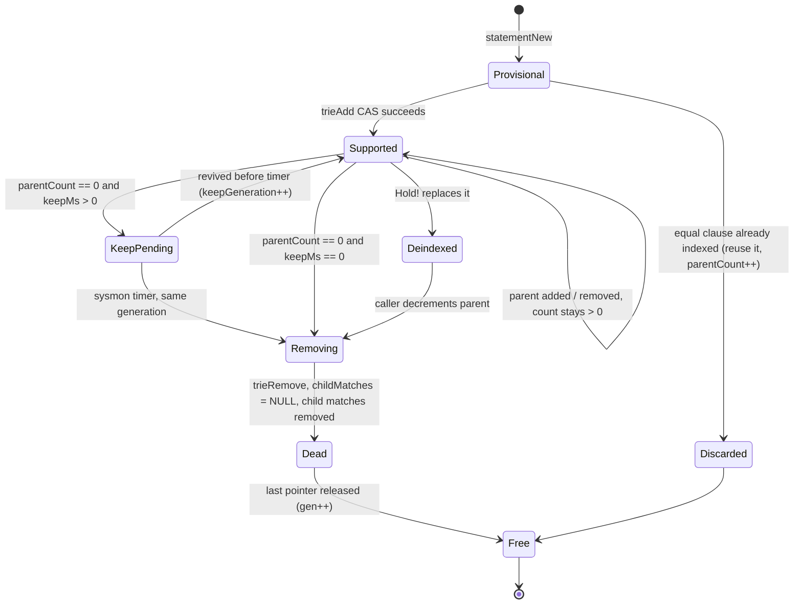
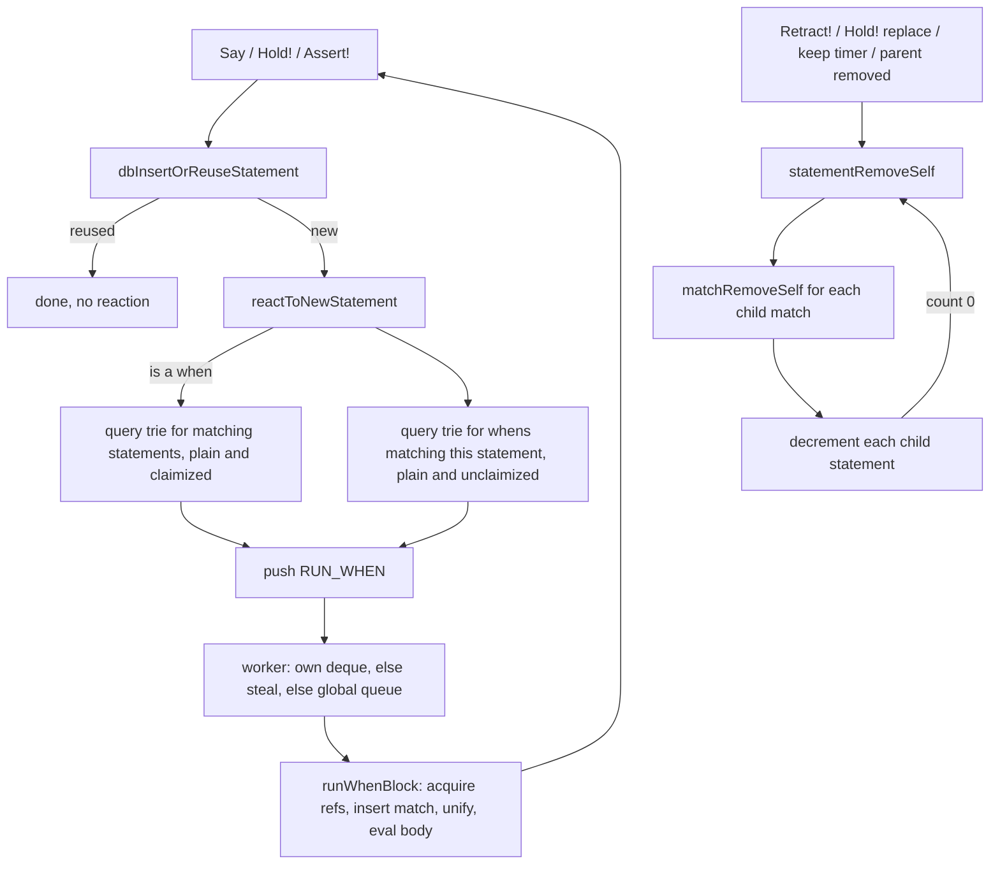

# Folk as a programming language: grammar, state model, and tooling survey

Research notes toward (a) optimizing Folk and (b) writing PL- and PPIG-style
papers about it. Based on a read of `prelude.tcl`, `folk.c`, `db.c`, `trie.c`,
`sysmon.c`, `boot.folk`, `builtin-programs/collect.folk`, and on small probe
programs run against a local build. Everything marked **(verified)** was
observed by running the probe; everything else is from reading the code.

Constraint honoured throughout: tooling should be written in what Folk already
uses (Tcl/Jim, C, Graphviz). The only new languages proposed are the input
languages of formal tools.

## 1. What Folk is, formally

Folk is two languages stacked:

1. **Host layer: Jim Tcl.** Scripts, words, substitution. Folk adds no lexer or
   parser of its own; `When`, `Claim`, etc. are ordinary procs
   (`prelude.tcl:398-643`).
2. **Folk layer: a word-level language.** Its "tokens" are Tcl words *after*
   substitution. Every form desugars to one primitive: emit a statement (a
   tuple of strings) into a shared database, with a provenance edge to the
   match that emitted it.

The runtime is a concurrent, incrementally maintained rule engine:

- A **statement** is a clause (list of string terms) stored in a persistent
  trie (`trie.c`), deduplicated by exact clause equality, with a support count
  (`parentCount`, `db.c:238`).
- A **rule** is itself a statement: `when <pattern> <body> with environment <envStack>`
  (`folk.c:1136`). Rules are matched against data, and data against rules,
  through the same trie, because lookup treats `/x/` as a variable on *either*
  side (`trie.c:269-335`).
- A **match** is one (rule, statement) pair whose body ran. Statements emitted
  by the body are its children. Removing *any* parent statement removes the
  match (`db.c:797-805`); a statement is removed when its *last* parent goes
  (`db.c:703`).

That is reference-counted truth maintenance: the "counting" algorithm for
incremental view maintenance, extended with timers (`-keep`), keyed mutable
cells (`Hold!`), events (`Subscribe:`/`Notify:`), and versioned snapshot
isolation (`-atomically`). The closest formal relatives are Datalog with
incremental maintenance, justification-based truth maintenance systems,
Dedalus (Datalog with explicit time), Constraint Handling Rules, and Linda
tuple spaces. A PL paper's contribution would be the precise semantics of the
combination, which does not appear to be written down anywhere.

## 2. Draft grammar

### 2.1 Host layer (Jim Tcl, abbreviated)

```ebnf
script   ::= { command ( NEWLINE | ";" ) }
command  ::= comment | word { WS word }
comment  ::= "#" { any-char-but-newline }      (* only where a command may start *)
word     ::= "{*}" word | braced | quoted | bare
braced   ::= "{" { any-char | braced } "}"     (* no substitution *)
quoted   ::= '"' { char | subst } '"'
bare     ::= ( char | subst ) { char | subst }
subst    ::= "$" name | "${" name "}" | "$(" expr ")" | "[" script "]" | "\" char
```

`$(expr)` is a Jim extension. A comment is only recognised at command
position, so a trailing comment needs `;#`.

### 2.2 Folk layer (over substituted words)

```ebnf
program     ::= script                         (* runs as a When body with `this` bound *)

form        ::= claim | wish | say | when | hold | assert | retract
              | subscribe | notify | unmatch | query | fn

claim       ::= "Claim" say-args               (* => Say $this claims ... *)
wish        ::= "Wish"  say-args               (* => Say $this wishes ... *)
say         ::= "Say"   say-args
say-args    ::= { say-opt | term }             (* options may appear anywhere *)
say-opt     ::= "-keep" duration | "-nonatomically" | "-destructor" script-word

when        ::= "When" { when-opt | pterm } { "&" pattern } body
when-opt    ::= "-noncapturing" | "-serially" | "-keep" duration
              | "-atomically" | "-atomicallyInherit" | "-nonatomically"
              | "-atomicallyWithKey" term

hold        ::= "Hold!" { hold-opt } hold-what
hold-opt    ::= "-on" term | "-key" term | "-keep" duration | "-version" number
              | "-source" term | "-destructor" script-word
              | "-noncapturing" | "-save" | "--"
hold-what   ::= body                           (* held rule *)
              | "Claim" clause | "Wish" clause | clause
              | ""                             (* clears the key *)

assert      ::= "Assert!" clause
retract     ::= "Retract!" pattern
subscribe   ::= "Subscribe:" pattern body
notify      ::= "Notify:" clause
unmatch     ::= "On" "unmatch" body

query       ::= "Query!" [ "-atomically" ] joined
              | "QueryOne!" { "-default" term | pterm } { "&" pattern }
              | ( "Require!" | "Expect!" ) joined
              | "ForEach!" joined body
joined      ::= pattern { "&" pattern }

fn          ::= "fn" name params body | "fn" name

clause      ::= term { term }
pattern     ::= pterm { pterm }
pterm       ::= var | term
var         ::= "/" varname "/" | "/..." varname "/"
varname     ::= non-space-char { non-space-char }      (* 1..99 chars *)
duration    ::= digit { digit } "ms"
body        ::= word whose value is a script
term        ::= any word value
```

Reserved variable names: `someone something anyone anything any` match without
binding (`trie.c:243`); `nobody nothing` negate the clause
(`prelude.tcl:470`).

### 2.3 Desugaring to the core

| Surface | Core |
|---|---|
| `Claim c` | `Say $this claims c` |
| `Wish c` | `Say $this wishes c` |
| `When p body` | `Say when p body with environment E`, E = captured locals |
| `When p1 & p2 body` | `When p1 { When p2' body }`, `/x/` bound by p1 becomes `$x` in p2 |
| `When /nobody/ p body` | `When the collected results for {/any/ p} are /__results/ { if empty body }` |
| `Subscribe: p body` | `Say subscribe p body with environment E` |
| `On unmatch body` | destructor on the current match |
| pattern `p` (2nd term not `claims`/`wishes`) | also matches `/someone/ claims p` (`folk.c:1112`) |

So the core calculus needs only: statements, `say`, `hold`, `assert/retract`,
`notify`, destructors, and the match rule. Everything else is sugar, and that
table is the first figure of a PL paper.

### 2.4 Grammar hazards found

These make the grammar non-obvious and each is either a bug to fix or a
semantic choice to document. All **(verified)** by probe.

| # | Behaviour | Where |
|---|---|---|
| G1 | Non-linear patterns are not checked. `/x/ likes /x/` matches `a likes b`, binding `x=b`. | `folk.c:163`, `trie.c:296` |
| G2 | `/...rest/` needs at least one term: `the list is /...r/` does not match `the list is`. | `trie.c:303` |
| G3 | A rest variable mid-pattern (`the /...r/ 3`) retrieves trie candidates, then unification fails with a stderr warning for each. | `trie.c:305`, `folk.c:189` |
| G4 | Option words are recognised anywhere in a clause. `Claim the flag is -keep 5ms` stores `the flag is`. | `prelude.tcl:409-427`, `512-547` |
| G5 | Any pattern term whose *value* starts with `$` is re-substituted with `subst` in the caller's scope, including command substitution. A data value `$this[puts INJECTED]` in a `When` pattern runs `puts`. | `prelude.tcl:482-483`, `695-696` |
| G6 | Literal `with` ... `handler` in a `Say` triggers environment capture on the next word. | `prelude.tcl:428-437` |

G5 is a hygiene problem (second-order evaluation of data) and the one I would
fix rather than document.

## 3. State model

### 3.1 Statement lifecycle (`db.c:686-808`, `1306-1500`)



### 3.2 Match lifecycle (`folk.c:880-1014`, `db.c:845-1008`, `1502-1597`)

```mermaid
stateDiagram-v2
    [*] --> Queued: RUN_WHEN pushed (weak refs to when + statement)
    Queued --> Dropped: either ref stale at dequeue
    Queued --> Running: dbInsertMatch (parents locked, destructors and versions inherited)
    Running --> Completed: body returns
    Running --> Removing: a parent statement removed
    Completed --> Removing: a parent statement removed
    Running --> PinnedOrphan: parent removed, match is an -atomically root
    Completed --> PinnedOrphan: parent removed, match is an -atomically root
    PinnedOrphan --> Removing: newer version converges, or timeout
    Removing --> Destroyed: children decremented; SIGUSR1 if body ran > 100ms
    Destroyed --> [*]: destructors run at last release
    Dropped --> [*]
```



### 3.3 Evaluator flow (`folk.c:1187-1314`, `1338-1523`)



### 3.4 Semantic findings that matter for a formal model

| # | Finding | Evidence |
|---|---|---|
| S1 | **Cyclic support is immortal.** `When a is cool { Claim a is cool }` plus a held `a is cool`: after the hold is cleared, the derived claim survives forever, supported by its own match. This is the textbook unsoundness of counting-based maintenance under recursion. | **verified**; `db.c:703` |
| S2 | Insert-vs-insert race: a new `when` and a new matching statement can each discover the other, running the body twice. Acknowledged in a FIXME. Children deduplicate, but body side effects do not. | `folk.c:1244` |
| S3 | `matchRemoveSelf` is flagged not thread-safe against concurrent removers. | `db.c:940` |
| S4 | Bodies are preemptible: a match removed while its body has run over 100ms gets its worker thread signalled. A semantics must treat bodies as interruptible. | `db.c:990-1006` |
| S5 | Errors are asymmetric: an error in a `When` body is logged; in a `Subscribe:` body it exits the process. | `folk.c:998` vs `1045-1053` |
| S6 | Negation and aggregation are not stratified: `/nobody/` is a `collect` re-run on a timer tick (`collect.folk:296`), so rules that negate their own consequences oscillate rather than being rejected. | `prelude.tcl:487-492` |
| S7 | Hard limits that a model should include or abstract: 65,536 statements and matches, 256 atomically keys, 50 bindings per match, 99-char variable names, 500 results per `Retract!`. | `db.c:384-403`, `folk.c:824`, `db.c:1600` |

S1 and S6 are where a formal semantics earns its keep: they are exactly the
places where Folk diverges from Datalog's fixpoint semantics.

## 4. Tool candidates

### 4.1 Producing and validating the BNF

| Candidate | Fit | Verdict |
|---|---|---|
| **Shadow-evaluation extractor in Jim** | Redefine `When`/`Claim`/`Wish`/`Hold!` as recording procs and `source` each `.folk` file under the vendored `jimsh`. Word boundaries come from the real parser, so there is no second Tcl parser to maintain. `boot.folk:74-104` already does this trick (`fake`) for macOS. | **Primary.** ~200 lines of Tcl. |
| Grammar recogniser in Tcl | Check each recorded form against section 2.2; report anything that does not parse. Turns the BNF into a tested artefact. | **Primary**, same script. |
| Nagelfar 1.3.5 | Pure-Tcl linter with a syntax database (`##nagelfar syntax When x* c`) and plugin hooks. Targets Tcl 8, so Jim-isms (`$(...)`, `local`, `info source`, `dict getdef`) will be false positives. | Secondary, for host-layer lint. |
| tclint 0.7 | Active, has an LSP, but is Python. | Only if Python counts as already present (`lib/python.tcl`). |
| tree-sitter-tcl | Stale since 2020, grammar in JavaScript. | No. |

Feasibility number from the corpus (builtin and user programs, line-initial
forms): 288 `When` heads, of which 66 contain a `$` substitution, 12 a `[...]`
and 1 a `{*}`. So roughly three quarters of rule heads are fully literal, and
most of the rest are literal in predicate shape with holes in value positions.
Static extraction is viable if holes are treated as wildcards.

### 4.2 Flow and state diagrams

- **Graphviz `dot`**: already a dependency (`builtin-programs/web/dep-graph.folk`
  renders the live statement/match graph). Use it for the *static* rule graph
  the extractor produces: node per rule, edge when an emitted clause unifies
  with a `When` pattern.
- **TLC's state-graph dump**: once the TLA+ model in 4.4 exists, TLC can emit
  the reachable state graph as `dot`. The paper's state diagram is then
  generated from the checked model instead of drawn by hand.
- Mermaid (as above) only for documentation.

### 4.3 Analysing Folk programs

Static, all built on the extractor's output:

1. **Rule dependency graph** and its SCCs. Any cycle is a candidate for S1;
   any cycle through `/nobody/` or `collect` is a candidate for S6.
2. **Dead rules and orphan wishes**: a `When` pattern nothing can emit; a
   `Wish` no `When` handles. For a system whose programs are written
   independently, this is the most useful day-to-day check.
3. **Pattern lints** for G1-G6.
4. **Free-variable analysis of bodies**, which also unlocks the biggest
   optimisation (5.2).

These analyses are Datalog-shaped, so they can be written *in Folk*: load the
extracted facts as claims and express each check as a `When`. That is both
within the language constraint and a good paper demonstration.

Dynamic, mostly already in the tree:

| Tool | State |
|---|---|
| Per-block runtime stats | `block-stats.c`, `web/block-stats.folk` |
| Tracy zones per match | vendored, `-DTRACY_ENABLE` |
| Live dependency and trie graphs | `web/dep-graph.folk`, `web/trie-graph.folk` |
| AddressSanitizer | `make ASAN_ENABLE=1` |
| ThreadSanitizer | not wired up; add a `TSAN_ENABLE` twin. First thing I would run. |
| Structured event trace | missing. One line per insert / reuse / match / unmatch / remove would enable offline replay and trace validation against the model. |
| Deterministic scheduler | missing. A single-worker, seeded mode in `workerLoop` makes tests reproducible and permits systematic interleaving exploration, in C, with no new tool. |

### 4.4 Formal verification

Three separate targets need three different tools.

**(a) The language semantics.** Recommended: **TLA+ (PlusCal optional), checked
with TLC, Apalache as a symbolic second opinion.**
The state is a set of statements, a set of matches and a support relation;
steps are say / match / remove / timer / hold. That is TLA+'s native shape, and
the interesting properties are temporal:

- *Support soundness*: every indexed statement has a live parent, a hold, or a
  pending keep timer. (S1 shows this holds while the intended "has a
  well-founded derivation" does not; the model should exhibit the
  counterexample.)
- *Quiescent agreement*: if inputs stop changing, the database converges to
  the least fixpoint of the rules, for recursion-free programs.
- *Atomicity*: an `-atomically` query never observes statements from an
  unconverged version (`folk.c:458`).
- *Hold monotonicity*: for a key, visible versions never go backwards
  (`db.c:1641-1731`).

Alternatives: **Alloy 6** suits the relational invariants (bipartite
statement/match graph, acyclicity) and is quicker for exploring designs.
**Rocq, Lean or Isabelle** only if the paper needs mechanised metatheory; that
is months, not weeks. PLT Redex and K would give an executable semantics but
bring in Racket or K for less payoff than TLA+ here.

**(b) The C runtime's lock-free code.** Recommended: **GenMC**, with TSan as
the cheap first pass. GenMC model-checks C programs using C11 atomics and
pthreads under RC11, through clang, so harnesses stay in C. Targets, smallest
first:

1. `genRcAcquire` / `genRcRelease` / `genRcMarkAsDead` (`db.c:50-97`): no
   acquire succeeds after the generation bump; exactly one releaser sees
   "last".
2. Trie CAS plus epoch reclamation (`db.c:1390-1481`, `epoch.c`): no reader
   touches retired memory.
3. The work-stealing deque (`workqueue.c`): no item lost or duplicated.
4. Atomically reaping (`db.c:1139-1205`, `944-962`): exactly one of reaper and
   remover claims the match.

Caveats: the public GenMC mirror lists LLVM support only up to 16, and
`GenRc` is a bit-field struct inside an `_Atomic`, which may need rewriting as
a plain `uint32_t` for the harness.

For sequential C: **CBMC** to bound-check the fixed buffers (`results[100]`,
`[10]`, `[500]`, `char name[100]` with `memcpy` at `folk.c:172`) and to check
`trieAdd`/`trieRemove`/`trieLookup` against a naive list model. **Frama-C WP**
is a good fit for `trie.c` specifically, since it is a pure persistent data
structure; annotations are ACSL comments in the C file.

**(c) Individual Folk programs.** There is no off-the-shelf tool. The
practical route is the static checks in 4.3, plus translating a program's
extracted rules into an instance of the TLA+ model from (a) for small bounded
checks ("this wish is eventually handled", "these two programs never both
claim X").

### 4.5 PPIG-style evidence

PPIG work needs instruments more than verifiers:

- **Corpus metrics** from the extractor. Baseline from this checkout (160
  `.folk` files, 22.5k lines, including tests): `When` 369, `Claim` 283,
  `Wish` 269, `fn` 180, `Hold!` 106; 108 `&` joins; 109 rest variables; 17
  `/nobody/` negations; 5 `When -atomically`.
- **Cognitive Dimensions of Notations** as the analytic frame. G1-G6 are ready
  examples of hidden dependencies and error-proneness; S1 is a viscosity and
  premature-commitment story.
- **Error and edit telemetry** recorded as statements: `evaluateBlock` already
  claims `<program> has error ...` (`prelude.tcl:183-198`) and the editor
  saves through `Hold! -save`, so logging needs no new machinery.

## 5. Optimisation leads

Ordered by expected payoff; each should be confirmed with block-stats, Tracy
or `perf` before work starts.

1. **Statements are strings end to end.** A `When` body and its whole captured
   environment are serialised into the statement, then re-parsed by each
   worker's interpreter (`folk.c:801-812`, `907`). A per-thread cache from term
   pointer to parsed `Jim_Obj` would remove most of this.
2. **Environment capture copies every local** at each `When`, `fn` and
   `Subscribe:` (`prelude.tcl:93-115`). With the free-variable analysis from
   4.3, capture only what the body mentions.
3. **Trie nodes scan children linearly** and re-detect variables by string
   scanning on every lookup (`trie.c:162`, `294-312`). Tag variable terms at
   insertion and hash or sort the children.
4. **Each new statement costs two to three trie queries** plus clause
   reallocation for claimizing (`folk.c:1187-1312`).
5. **Polling**: `collect` runs off the `internal time` tick, `Expect!` sleeps
   100ms, and an idle `workerLoop` spins (`folk.c:1518`).
6. `matchNew` probes the 65,536-slot pool linearly for a free slot
   (`db.c:850`).

## 6. Suggested order

1. Extractor, grammar recogniser and lints in Tcl; emit `dot`. Gives the
   tested BNF, the static flow diagram and the corpus numbers at once.
2. TSan build target; fix what it finds.
3. TLA+ model of the core (statements, matches, keep, hold); reproduce S1 as a
   counterexample; generate the state diagrams from it.
4. Event trace and deterministic scheduler; validate traces against the model.
5. GenMC harnesses for `GenRc`, then trie and epoch.
6. Decide G1-G6 and S1, S2, S5, S6: fix or specify.

## Sources

- [Nagelfar](https://nagelfar.sourceforge.net/), [release files](https://sourceforge.net/projects/nagelfar/files/Rel_135)
- [tclint](https://pypi.org/project/tclint)
- [GenMC](https://plv.mpi-sws.org/genmc/), [CAV 2021 paper](https://plv.mpi-sws.org/genmc/cav21-paper.pdf), [mirror](https://github.com/mpi-sws/genmc/)
- [Dedalus: Datalog in Time and Space](https://www2.eecs.berkeley.edu/Pubs/TechRpts/2009/EECS-2009-173.html)
- [Folk notes: language inspiration](https://folk.computer/notes/language-inspiration)
- [PPIG: Cognitive Dimensions literature review (2017)](https://www.cl.cam.ac.uk/~mcm79/ppig/files/2017-PPIG-28th-hadhrawi.pdf), [Clarke, PPIG 2001](https://www.ppig.org/papers/2001-ppig-13th-clarke/)
