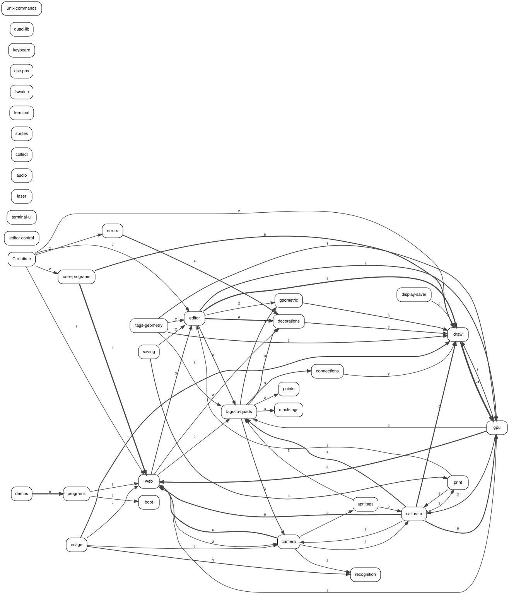
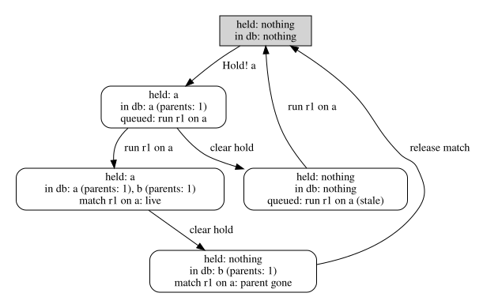

# Findings from running the tools on Folk

The tools proposed in [`docs/pl-research.md`](../docs/pl-research.md) were
installed on a cloud VM, built where they did not exist, and run against this
tree (commit `587e242`). This is what they found, in three groups: things
worth knowing about the language, defects with a reproducer each, and places
where time goes, measured with the profilers the Makefile already uses.

The machine: 4 vCPUs, 15 GB, Ubuntu 24.04, kernel 6.18, gcc 13.3. No camera,
projector or GPU, so everything here concerns the language, the evaluator and
the text of the programs. Nothing about vision or rendering was exercised, and
absolute timings will differ on a real table.

How to rerun any of it is in [`README.md`](README.md).

## The short version

- **Three defects can crash Folk or run a rule that should not run**, each
  with a reproducer of a few lines: a statement that is a prefix of a
  `... with /...options/` pattern fires that rule with `options` unbound
  (E1); `On unmatch` outside a match segfaults (E2); and a diagnostic
  `KILL (...)` message reads freed memory, which crashed the stock build in
  two runs out of three of its reproducer (E3).
- **An idle Folk uses every core it has.** With nothing to do it took 3.8 of 4
  CPUs and grew to 33 threads. One rule body blocked in a system call was
  enough to push the 99.9th-percentile step of a reactive loop from 0.6 ms to
  21 ms (O1).
- **Every rule firing pays for the size of the scope it was written in.**
  The same pipeline ran 6,280 steps a second with no helper functions in scope
  and 1,358 with forty that it never calls (O2).
- The lock-free core held up: GenMC found no error in the work-stealing deque
  or in the generation/refcount word. Of ThreadSanitizer's 293 reports over
  the test suite, 254 come from one thing it cannot model, and the other 39
  are three real defects at the edges (section 4).
- The grammar is now executable and tested, and there is a checked model of
  the evaluator that produces two of the defects as counterexamples
  (section 1).

## 1. Interesting

### I1. The grammar is small, and a parser for it agrees with Jim on every file

`extract/tclparse.tcl` is the host-layer grammar as a recursive-descent parser
in under 500 lines of Tcl; `extract/folkforms.tcl` is the Folk layer on top of it.
Neither evaluates anything. `extract/difftest.tcl` compares the parser with
Jim's own tokenizer (reached by compiling `jim.c` into a small oracle) on every
`.folk` and `.tcl` file in the tree, and then on the contents of every braced
word, recursively, which means on all the C, GLSL, HTML and JavaScript embedded
in the programs as well:

    difftest: 20404 scripts, 47389 commands, 159366 words, 0 mismatches

So the host-layer grammar is tested against the implementation, not only read
off it. The Folk layer is checked the other way round: the recogniser accepts
every form in the 160 programs and tests except one (`On process`, E15).

One thing the recogniser had to copy from `prelude.tcl` is worth stating in a
paper: `When`, `Claim`, `Wish`, `Hold!` and `Query!` each scan their own
argument list for option words, so the Folk layer has no fixed position for
options. In the tree, options come before the clause, except 16 times where
they follow it (`Claim ... -destructor {...}`, `QueryOne! ... -default x`).

### I2. What Folk programs are made of

From `out/metrics.txt`, over the 125 programs `boot.folk` loads (21,634 lines):

| | |
|---|---|
| `When` | 282 |
| `Wish` | 194 |
| `Claim` | 181 |
| `fn` | 143 |
| `Hold!` | 95 |
| `Query!` and relatives | 80 |
| `Subscribe:` / `Notify:` | 14 / 11 |
| Rules with more than one clause (`&`) | 101 of 283 |
| Rules nested inside another rule | 122 of 283 |
| Clauses with a `/...rest/` variable | 71 |
| Clauses negated with `/nobody/` | 19 |
| Rule patterns that are fully literal | 207 of 283 |

A clause is most often 5 or 6 terms long. The programs use 350 distinct
statement shapes (a clause with everything but its literal words blanked out).

### I3. The programs meet on statement shapes, and those can be drawn

Folk programs do not import one another. `extract/analyze.tcl` recovers who
talks to whom by unifying every statement a program can emit against every
pattern in the tree (a term computed at run time matches anything, so the
graph over-approximates). The result is 940 rule-to-rule edges and 499
program-to-program edges. Folded by directory:



The label on an edge is the number of distinct statement shapes it carries.
Edges that carry a single shape are left out to keep the picture readable,
which is why some nodes stand alone.
[`out/programs.svg`](out/programs.svg) is the same per program and
[`out/rules.svg`](out/rules.svg) per rule; both are large and meant for
zooming. Every edge has the shapes it carries as a tooltip.

[`out/interfaces.tsv`](out/interfaces.tsv) lists each shape with its producers
and readers. The busiest are the de facto interfaces of the system:

| Statement shape | Producers | Readers |
|---|---|---|
| `_ claims the image library is _` | 1 | 20 |
| `_ claims _ has canvas _ with ...` | 3 | 14 |
| `_ claims _ has resolved geometry _` | 4 | 13 |
| `display _ has width _ height _` | 1 | 13 |
| `the collected results for _ are _` | 1 | 13 |
| `_ claims _ has quad _` | 4 | 8 |
| `sysmon.c claims the clock time is _` | 1 | 9 |

Two things fall out of the same data:

- **Folk's public surface is the set of patterns nothing in the tree emits.**
  There are 80 ([`out/unmatched.tsv`](out/unmatched.tsv)): 45 wishes that
  programs on the table are expected to make (`/someone/ wishes /p/ draws a
  /shape/`), 26 claims that configuration is expected to make (`printer /x/ is
  the default printer`), and 9 rules about rules. That list is the closest
  thing there is to an API reference, and it is generated.
- **Six wishes are never reacted to, only polled**
  ([`out/polled.tsv`](out/polled.tsv)). `the GPU draws pipeline ... with ...`
  and `the GPU runs frame prelude handler ...` are read by `Query!` and
  `ForEach!` in `gpu/draw.folk`, not by a rule. The reactive database is used
  as a pull-based draw list there.

### I4. A checked model of the evaluator, and the lifecycle it implies

[`model/Folk.tla`](model/Folk.tla) models statements with support counts,
rules, matches, queued reactions and the removal cascade. TLC checks six
properties on a three-statement, two-rule acyclic program (46,201 states, all
hold). On two other configurations it produces counterexamples to two of them
(E4 and E12 below). The
state graph of the smallest program, `When a { Claim b }` with one `Hold!` key,
is generated by TLC and relabelled by `model/pretty-dot.tcl`:



The branch on the right is the one that makes the runtime's references weak:
a reaction is queued, its statement goes away before a worker gets to it, and
the stale item is dropped when it is taken.

### I5. A chart of execution

A Tracy capture of `bench/pipeline.folk`, exported with `tracy-csvexport -u`
and drawn by `bench/timeline.tcl`:


The first millisecond is the normal picture: one worker runs the four rule
bodies of each step back to back, about 250 µs a step. Then one run of the
join rule takes 3 ms of wall time, for a body whose other runs take around
100 µs, and the pipeline stalls for a millisecond until a second worker steals
the next step. The process had 15 threads on 3 usable cores during this
capture; O1 is about why, and measures what it costs.

### I6. Idioms the analysis surfaced

- **Default unless someone says otherwise.** A rule that tests for absence and
  then `Hold!`s the missing statement settles, because the hold outlives the
  match (`editor/editor.folk:84`, `calibrate/session.folk:336`). The same rule
  with `Claim` oscillates (E11). `out/cycles.txt` tells the two apart.
- **Plain form plus options form.** `When ... /x/ { Wish ... $x with defaults }`
  next to `When ... /x/ with /...options/`. This pair is exactly what E1 breaks.
- **Rules about rules.** Fifteen patterns begin with `when` and match other
  programs' rules as data; the collector and the recognition programs are
  built this way.
- **A program switched off by a first-line `return`.** `group.folk` does this.
  The analysis stops at an unconditional top-level `return` and says so.

### I7. Rule bodies use a third of what they capture

A `When` captures every local variable in scope, and every `fn`, into the rule
statement. Over the 343 capturing rule bodies in the tree
([`out/capture.tsv`](out/capture.tsv)), a body has 6.7 variables captured for
it on average and can read 2.2 of them; 68% of what is captured is never read,
and 231 of those unread captures are whole function bodies. This is a static
estimate (the body's free variables, plus those of the rules nested in it and
of the fns it calls). O2 measures what the captured environment costs.

## 2. Qualified errors

E1 to E12 each have a reproducer in [`repro/`](repro/) whose header says what
was expected and what happens; `repro/run.sh` runs them all. E13 has one as
well, but it did not hit the race in a full Folk run, so E13 to E16 rest on
the evidence named in the last column. "Stock build" means `./folk` as `make`
produces it.

| | Defect | Effect | Evidence |
|---|---|---|---|
| E1 | Prefix of a `/...rest/` pattern fires the rule | wrong rule runs, variable unbound | reproducer; `test/options.folk`; 8 exposed pairs in tree |
| E2 | `On unmatch` with no current match | segfault | reproducer; `test/python.folk` |
| E3 | `KILL` diagnostic reads a freed clause | segfault | ASan, TSan, gdb on stock build |
| E4 | Statement supported only by itself is never removed | stale statements | reproducer; TLC counterexample |
| E5 | Pattern term starting with `$` goes through `subst` | error, or data runs as code | reproducer |
| E6 | A variable used twice in a clause is not checked | wrong matches | reproducer |
| E7 | Option words are consumed anywhere in a clause | statement silently shortened | reproducer |
| E8 | A stored term shaped like `/x/` is a wildcard | wrong matches | reproducer |
| E9 | 100-byte variable name overflows a buffer by one | stack byte overwritten | ASan; CBMC |
| E10 | Large query or retract ends the process | exit, uncatchable | two reproducers |
| E11 | A rule that claims what it negates never settles | busy loop | reproducer |
| E12 | Rule and statement added together run the body twice | duplicated side effects | stress reproducer; TLC counterexample |
| E13 | Hash lookups under a read lock exchange results | stats and logs misattributed | TSan; isolated stress |
| E14 | Seven of 35 tests do not pass here; two hang | nothing guards regressions | test runs |
| E15 | Code that refers to things that no longer exist | dead rules | static analysis |
| E16 | Two small undefined behaviours | none observed | UBSan; TSan |

### E1. A statement that is a prefix of a `/...rest/` pattern fires the rule

```tcl
When /someone/ wishes /p/ draws text /text/ with /...options/ {
    puts "options bound: [info exists options]"
}
sleep 0.3
Wish page draws text late       ;# no `with`, no options
# prints: options bound: 0
```

The rule runs although its pattern does not match, and only when the statement
arrives after the rule. Two things combine:

1. To find the rules a new statement should fire, `reactToNewStatement`
   (`folk.c:1257`) queries the trie for
   `when <the statement> /__lambda/ with environment /__env/`. A rule is stored
   as `when <pattern> <body> with environment <env>`. `trieLookupImpl`
   (`trie.c:303-317`) returns everything below a stored `/...rest/` without
   looking at what is left of the query, so the query's own tail can be what
   reaches it: above, `/__lambda/` lines up with the pattern's `with`, and the
   literal `with` meets `/...options/`. A statement two terms shorter than the
   pattern always gets through; one three terms shorter does if the term
   before the rest variable is `with` or a variable.
2. `clauseUnify` (`folk.c:167`) compares the terms both sides have and never
   checks that the lengths agree, so the pair is accepted.

When the rule arrives second, the lookup runs the other way and correctly
finds nothing, which makes the behaviour depend on arrival order.

This is known in one place: `builtin-programs/editor/editor.folk:61` begins

```tcl
When /editor/ is an editor with /...options/ {
    # HACK: because we partial match
    if {![info exists options]} { return }
```

`test/options.folk` was written to catch it and currently fails. The analyzer
lists every statement in the tree that can do this to a rule in the tree
([`out/prefix-fires.tsv`](out/prefix-fires.tsv)): 8 pairs over 7 rules. Four
of them are `Claim $editor is an editor` (`editor.folk:28`) against the four
`/editor/ is an editor with /...x/` rules, three of which have no guard.

**Next step.** Have `clauseUnify` fail when the lengths differ and no rest
variable takes up at least one remaining term; that alone stops the wrong
firing. Then stop the rule lookup from letting pattern terms meet the
`/__lambda/ with environment /__env/` suffix, for instance by indexing rules by
pattern in their own trie. Decide at the same time whether `/...rest/` may
match zero terms; today it may not, in the one direction that works.

### E2. `On unmatch` outside a match segfaults

```tcl
On unmatch { puts "cleaning up" }
# Segmentation fault (exit status 139)
```

`DestructorFunc` (`folk.c:434`) passes `self->currentMatch` to
`matchAddDestructor` (`db.c:922`) without checking it. The top level of the
boot program has no current match, and every file in `test/` runs as the boot
program. `lib/python.tcl:393` calls `On unmatch` from `Uvx`, inside a `catch`
that cannot catch a signal, so `test/python.folk` dies on its first line.

**Next step.** Return a Tcl error when there is no current match, as
`CurrentMatchInheritStatementDestructors!` already does (`folk.c:539`).

### E3. The `KILL (...)` diagnostic reads a clause another thread is freeing

When a match is removed while its body has been running for over 100 ms,
`matchRemoveSelf` (`db.c:990-1006`) prints what the worker is doing. It copies
the worker's current work item under a mutex, releases the mutex, and then
formats the clause the item points to. The worker owns that clause and frees
it as soon as the body returns (`folk.c:1392`), before it clears the item.

`repro/kill-diagnostic.folk` starts bodies that take just over 100 ms and
retracts their parent statements as they finish. Under ASan it produced four
`heap-use-after-free` reports and one `SEGV` in 500 rounds. The stock build
crashed in two of three runs; gdb shows the same path
([`out/sanitizers/kill-diagnostic-backtrace.txt`](out/sanitizers/kill-diagnostic-backtrace.txt)):

    Thread 227 "folk" received signal SIGSEGV, Segmentation fault.
    #1  clauseToString (c=...) at trie.c:110
    #2  traceItem (...) at folk.c:1456
    #3  matchRemoveSelf (...) at db.c:999
    #4  statementRemoveSelf (...) at db.c:803

Any rule body that takes longer than 100 ms and whose input changes as it
finishes is exposed: camera work, a Python call, printing.

The same reproducer has also ended in two other ways under ASan, once each
over six runs. One was a SEGV in Jim's `signal_handler`
(`vendor/jimtcl/jim-signal.c:44`, which stores through a thread-local pointer
that was NULL in the thread that received the signal; the summary line is in
[`out/repro.txt`](out/repro.txt)). That fits the signal being sent to
`threads[match->workerThreadIndex].tid`: by then the slot can belong to a
newly spawned worker that has no interpreter yet. The other was the whole
process terminated by SIGUSR1; that one was not root-caused.

**Next step.** Format the message while holding `currentItemMutex`, and free
the item's clause only after `currentItem` has been cleared under that mutex.
For the signal, check under the same mutex that the worker is still running
the match being removed before sending it.

### E4. A statement supported only by itself is never removed

```tcl
When a is cool { Claim a is cool }     ;# also matches its own claim
Hold! -key base a is cool
sleep 0.5
Hold! -key base {}                     ;# clear the hold
sleep 1
Query! /p/ claims a is cool            ;# still one result
```

Reference counting cannot tell a statement with outside support from one
whose only parent is a match that descends from it. `model/MC_Cycle` shows the
same thing in seven steps with `When a {Claim b}`, `When b {Claim c}`,
`When c {Claim b}`: after the hold on `a` is cleared, `b` and `c` remain, each
supported by the match on the other, and the invariant "the database equals
the Datalog fixpoint" fails while "reference counts are exact" still holds.

The tree has no confirmed instance. `out/cycles.txt` lists four cycles of rules
and four rules that can feed themselves. Those inspected are on predicates
such as `has quad` and `has canvas`, where the subject differs from one step
to the next; they are listed as candidates, not as defects.

**Next step.** Decide whether this is the intended semantics. If it is, the
lint is already there. If not, removal needs to look for outside support
(delete and re-derive, or a reachability check from held statements when a
count drops but stays above zero).

### E5. A pattern term that starts with `$` is passed to `subst`

```tcl
set price {$5.00}
When the price is $price { }
# error: can't read "5": no such variable

set label "\$\[exec sh -c {echo a command ran >> /tmp/log}\]"
When the label is $label { }
# the command runs
```

`desugarWhen` (`prelude.tcl:482`) and `Query!` (`prelude.tcl:695`) call
`subst` on any term whose value begins with `$`. The intent is to resolve the
`$x` that the `&` desugaring writes for a variable bound by an earlier clause,
but the test is on the value, so it also catches data. 75 rule patterns in the
tree have a term computed at run time.

**Next step.** Have the join rewrite mark the terms it introduces and
substitute only those.

### E6. A variable that occurs twice in a clause is not required to agree

```tcl
Assert! a likes b
Assert! c likes c
Query! /x/ likes /x/       ;# two results: x = b and x = c
```

Neither the trie nor `clauseUnify` compares the two bindings; the second wins.
No pattern in the tree does this (the `nonlinear` lint is clean).

**Next step.** Compare on the second binding in `clauseUnify`, or reject such
patterns when the rule is made.

### E7. Option words are consumed anywhere in a clause

```tcl
Claim the flag is -keep 5ms
Query! /p/ claims the flag /...rest/     ;# rest = "is"
```

`Say` and `When` scan every argument for `-keep`, `-destructor` and the rest
(`prelude.tcl:409`, `512`), so a statement cannot contain those words. The
tree relies on options after the clause 16 times and never has one in the
middle.

**Next step.** Accept options before and after the clause only, and say so in
the grammar.

### E8. A stored term shaped like `/x/` matches every query

```tcl
Assert! the upload directory is /tmp/
QuerySimple! 0 the upload directory is elsewhere    ;# 1 result: the /tmp/ statement
```

A term is a variable if it starts and ends with `/` and has no space
(`trie.c:226`), and the trie applies that to stored statements as well as to
patterns, which is how rules are found. A directory path with a trailing
slash, or a regular expression, is such a term.

**Next step.** Treat `/x/` as a variable in stored terms only for statements
that are rules (`when ...`, `subscribe ...`).

### E9. A 100-byte variable name overflows its buffer by one byte

`trieScanVariable` (`trie.c:232`) rejects names longer than the buffer with
`varLen > sizeOutVarName`, then writes the terminator at
`outVarName[varLen]`. Every caller passes a 100-byte buffer, so a name of
exactly 100 bytes writes one byte past it. ASan reports it from
`repro/long-variable-name.folk`; CBMC finds it without running anything
(`make -C research/verify cbmc`: 1 of 837 checks fails, at `trie.c:240`).

**Next step.** `>=`.

### E10. A large query or retract ends the process

```tcl
for {set i 0} {$i < 9000} {incr i} { Assert! item $i exists }
sleep 3
catch { Query! item /i/ exists }
# stderr: dbQuery: Too many results for query (item /i/ exists )
# exit status 1; the catch never returns
```

`dbQuery` (`db.c:1045`) doubles its result buffer up to 8,000 entries and then
calls `exit(1)`. `dbRetractStatements` (`db.c:1610`) does the same at 500, so
`Retract! scratch item /i/` over 600 statements also ends the process
(`repro/retract-too-many.folk`). The Statements web page
(`web/statements.folk:6`) and `/dep-graph.pdf` both query every statement, so
on a system holding 8,000 statements, opening either would stop Folk.

**Next step.** Grow the buffer without a cap, or return an error to the caller.

### E11. A rule that claims what it tests the absence of never settles

```tcl
When /nobody/ claims the lamp is on {
    Claim the lamp is on
}
# the body ran 8,733 times in 3 seconds (10,022 in a second run)
```

The claim falsifies the premise, the match is removed, the claim goes with
it, and the premise is true again. Datalog rejects such programs
(unstratified negation); Folk runs them at the speed of the collector. The
only candidate in the tree, `editor/editor.folk:23`, negates one subject and
claims another, so it is not an instance.

**Next step.** Document `Hold!` as the way to write a default (I6). A warning
when a rule's own body emits something its negated clause matches would catch
the obvious cases; `out/cycles.txt` already computes that.

### E12. A rule and a statement added at the same moment run the body twice

`reactToNewStatement` indexes a statement and then scans for its
counterparts. When a rule and a matching statement are added by two threads at
once, each scan finds the other (the `FIXME` at `folk.c:1244`).
`repro/double-run.folk` asserts 3,000 such pairs back to back:

    3000 rounds: 3000 bodies ran at least once, 17 ran twice

(22 in a second run.)

`model/MC_Race` reproduces it as a violation of `AtMostOnce`;
`MC_RaceAtomic`, the same model with indexing and scanning as one step,
passes. Statements the two runs claim are merged by reuse, so the visible
effect is limited to side effects in the body.

**Next step.** Make the pair (rule, statement) unique at the point where a
match is attached. `dbInsertMatch` holds both parents' child-match locks
there, so it is the place to notice that the same pair is being attached a
second time.

### E13. Hash lookups under a read lock can return another thread's entry

`block-stats.c:36` and `output-redirection.c:200` call `shgetp_null` under
`pthread_rwlock_rdlock`. In stb_ds that macro stores the index it found in the
map's header and then reads the header back (`vendor/stb_ds.h:654`), so it is
a write. ThreadSanitizer reports both sites. An isolated stress of the same
pattern, with stb_ds compiled separately as it is in Folk
(`make -C research/verify stbds-race`), gave:

    40000000 lookups under a read lock, 15673 returned the other thread's entry

(4,700 in a second run.)

In Folk the effect would be a block's runtime added to another block's
statistics, or a program's output attached to another program's log file.
`repro/output-crosstalk.folk` did not catch it in a full run (0 of 12,538
lines), so it is rare there.

**Next step.** Call `stbds_hmget_key_ts` with a local index, or take the write
lock.

### E14. Seven of the 35 tests do not pass here, and two of them hang

| Test | Result on the stock build | Cause |
|---|---|---|
| `options` | exit 1 | E1 |
| `python` | segfault | E2 |
| `backtrace`, `fn` | never exit | they assert `$lineno == 4`; stack traces now carry `4:4` (line and column) |
| `collect-race` | failed in 3 of 8 runs | waits 200 ms for a first collection that took 183 ms here |
| `homography` | exit 1 | needs libapriltag built; not a defect |
| `ws` | never exits | needs `websocat` and retries forever without it; not a defect |

`make test` has no timeout, so it stops at `backtrace`, and there is no CI
configuration in the repository.

**Next step.** Compare `[lindex [split $lineno :] 0]` in the two stale tests,
give the `test` target a per-test timeout, and run it somewhere on push.

### E15. Code that refers to things that no longer exist

Found by matching emissions against patterns and by checking every command
name against `[info commands]` of a booted Folk:

- `builtin-programs/connections.folk:14-19` wishes `... is connected to $sink
  from centroid to centroid`. Nothing reads that shape; the handlers at lines
  60 to 65 expect `... with /...options/`. The form documented at the top of
  the file, `Wish $this is connected to $p from right to left`, matches no
  handler either.
- `builtin-programs/geometric/intersect.folk` (the `has neighbors` wish)
  depends on `/p/ has region /r/`, which no built-in program claims any more,
  and calls `regionToBbox`, which is defined nowhere.
- Programs under `user-programs/` call `Assert` and `Retract` without the
  `!`, `On process`, `chan`, and `region`, and match `the camera frame is
  /im/`. The comment at `print/print.folk:5` shows `Assert` as well.

**Next step.** Delete or port them. `make -C research/extract` regenerates the
lists (`unmatched.tsv`, `unhandled.tsv`, `undefined-commands.tsv`).

### E16. Two small undefined behaviours

- `runBlock` (`folk.c:832`) declares `Jim_Obj *objs[env->nBindings*2]`, a
  zero-length array whenever a rule binds nothing (UBSan, 17 reports).
- `threads[i].workQueue` is written by a starting worker and read by thieves
  without synchronisation (`folk.c:1489` and `1536`; TSan). A thief sees NULL
  or a queue whose zeroed state reads as empty, so nothing goes wrong on
  x86-64.

## 3. Optimisation opportunities

Measured with what the Makefile already wires up: perf and FlameGraph
(`make flamegraph`; here with the `cpu-clock` event and frame-pointer stacks,
since the VM has no hardware counters), Tracy (`-DTRACY_ENABLE`; captured
headless with `tracy-capture` and exported with `tracy-csvexport`), the
per-block statistics from `block-stats.c`, and Tcl's `time`.

The workload is [`bench/pipeline.folk`](bench/pipeline.folk): a loop that
drives itself, in which each step replaces one held statement, three rules
react (one a two-clause join) and the last one holds the next step. A step
creates five statements and five matches and removes the previous step's.
Tables are in [`out/perf/`](out/perf/); each configuration was run three times
and the median is quoted.

### O1. Idle workers spin, and blocked ones make the pool grow

`workerLoop` (`folk.c:1495`) never sleeps: with nothing to take or steal it
loops. `sysmon` (`sysmon.c:127`) counts a worker as available only if the
kernel reports it running, and starts another whenever fewer than the target
are; nothing ever retires one.

**Idle.** `bench/idle.folk` sleeps for ten seconds
([`out/perf/idle.txt`](out/perf/idle.txt)):

| | CPUs used | Context switches in 10 s | Threads after 10 s |
|---|---|---|---|
| Stock | 3.81 | 13.5 million | 33 |
| What-if | 0.22 | 0.18 million | 4 |

In the flame graph ([`out/perf/idle.svg`](out/perf/idle.svg)) 45% of the
samples are in `workQueueSteal`, `workQueueTake` and `workerSteal`, and 36%
in the kernel serving `sched_yield`.

**Under load.** A rule body parked in a system call stands in for a body
waiting on a camera, a socket or a subprocess
([`out/perf/pipeline.txt`](out/perf/pipeline.txt)):

| Blocked bodies | Build | Steps/s | Threads | Step p50 | p99 | p99.9 |
|---|---|---|---|---|---|---|
| 0 | stock | 6,280 | 6 | 147 µs | 349 µs | 0.55 ms |
| 1 | stock | 3,736 | 31 | 146 µs | 710 µs | 21 ms |
| 3 | stock | 2,043 | 66 | 171 µs | 4.3 ms | 60 ms |
| 0 | what-if | 4,624 | 5 | 200 µs | 420 µs | 0.82 ms |
| 1 | what-if | 4,424 | 5 | 204 µs | 446 µs | 0.73 ms |
| 3 | what-if | 4,178 | 8 | 216 µs | 463 µs | 0.72 ms |

The median step barely moves; the tail does. With one blocked body, one step
in a thousand takes longer than a 60 Hz frame. I5 shows one such stall.

The what-if build is [`bench/patches/idle-backoff.patch`](bench/patches/idle-backoff.patch),
15 added lines: a worker that finds nothing 200 times in a row naps for 50 µs, and
`sysmon` counts a worker that is between work items as available. It is an
experiment to size the opportunity, not a proposed change: the nap costs the
uncontended case about a quarter of its throughput, which a wake-up on push
would not.

**Next step.** Park idle workers on a futex or semaphore and wake one when
work is pushed; count a worker as blocked only while it is inside a work item;
retire workers that have been surplus for a while.

### O2. Each rule firing pays for the size of the environment it captured

The same pipeline, with helper `fn`s in scope that no rule calls:

| `fn`s in scope | Captured environment | Steps/s | Per step |
|---|---|---|---|
| 0 | 0.4 KB | 6,280 | 159 µs |
| 10 | 4.7 KB | 2,978 | 336 µs |
| 40 | 17.6 KB | 1,358 | 736 µs |

[`bench/costs.folk`](bench/costs.folk) times the pieces with Tcl's `time`
from inside a rule body (smallest of five runs,
[`out/perf/costs.txt`](out/perf/costs.txt)):

| | 0 fns | 10 fns | 40 fns |
|---|---|---|---|
| Parse the environment from its string | 3.0 µs | 24 µs | 97 µs |
| Enter an empty body, environment already parsed (`evaluateBlock {}`) | 4.6 µs | 24 µs | 83 µs |
| - of which: `rename` every fn to delete its proc | 1.0 µs | 13 µs | 57 µs |
| - the same, skipping fns that have no proc | 1.0 µs | 4.2 µs | 13 µs |
| - of which: bind the variables and `apply` | 0.9 µs | 1.5 µs | 3.0 µs |
| Make a rule (`When`, nothing matches) | 30 µs | 44 µs | 90 µs |
| - of which: `captureEnvStack` | 4.3 µs | 8.6 µs | 21 µs |

Three specific costs, each proportional to the environment:

1. **The environment is re-parsed from a string on every firing.** It is a
   term of the rule statement, and `runWhenBlock` makes a fresh Jim object from
   that term each time (`folk.c:908`).
2. **`runWhenBlock` parses it twice more to look for a marker.** It calls
   `Jim_ListLength` on the environment stack and on its last frame to see
   whether that frame is `{__atomicallyKey ...}` (`folk.c:934-938`). In the
   flame graph of the 40-fn run
   ([`out/perf/pipeline-fns40.svg`](out/perf/pipeline-fns40.svg)),
   `JimParseSubBrace` is the top function at 13.0% of all samples, and 89% of
   that is reached through those two calls.
3. **`applyBlock` deletes every fn's proc on every entry**
   (`prelude.tcl:153-162`) with `try { rename ... } on error`, and the proc
   usually does not exist, so the cost is that of raising and discarding an
   error per fn. Checking `exists -command` first removes most of it (57 µs
   becomes 13 µs).

I7 gives the static side: two thirds of what is captured is never read.

**Next step.** In order of effort: test for the marker without parsing (keep
it as its own term of the rule statement); guard the `rename`; cache the
parsed environment per interpreter, keyed by the term; capture only the
variables a body can read, using the free-variable analysis in
`extract/analyze.tcl`.

### O3. The Tcl in front of each primitive costs more than the primitive

From the same table, with a small environment:

| | Time |
|---|---|
| `QuerySimple!` (C, one result) | 0.8 µs |
| `Query!` (the Tcl wrapper around it) | 8.8 µs |
| `Claim` of a new statement | 16 µs |
| `Hold!` | 13 µs |

In the flame graph of the pipeline
([`out/perf/pipeline-fns0.svg`](out/perf/pipeline-fns0.svg)), running rule
bodies is 50% of all samples, and the database work reached from them
(`SayWithSourceFunc`, `HoldStatementGloballyFunc`, `dbInsertMatch`,
`statementRemoveSelf`) adds up to about 12%. The rest is Jim evaluating
`Say`, `When`, `Query!` and `evaluateBlock`, which walk their argument lists
word by word on every call, and `malloc`/`free` (16%).

**Next step.** Move the argument scanning of `Say`, `Claim`, `Wish` and
`Query!` into the C commands. This was not tried, so the gain is an estimate:
the C primitives are an order of magnitude cheaper than their wrappers.

### O4. Trie nodes with thousands of children: confirmed, small today

`trieAddImpl` scans a node's children linearly and copies the node to add one
(`trie.c:162`, `206`). Adding N statements under one node against the same N
spread over nodes of at most 100 children
([`out/perf/trie-width.txt`](out/perf/trie-width.txt)):

| N | One wide node | Bucketed |
|---|---|---|
| 1,000 | 6.6 µs per statement | 3.0 µs |
| 4,000 | 12.5 µs | 3.1 µs |
| 7,000 | 18.0 µs | 3.0 µs |

The cost grows with the width as expected, but a statement already costs
16 µs in Tcl before it reaches the trie (O3), so this only matters for
programs that keep thousands of same-shaped statements.

### Not confirmed

- **A faster allocator.** `malloc` and `free` are 16% of the pipeline's
  samples. Preloading tcmalloc gave +22% in one configuration and -46% in
  another, with the thread count swinging between 4 and 29 across runs (O1),
  so there is no result yet. Worth repeating once the pool is stable.
- **Leaks.** `Exit!` ends the process with `_exit`, so LeakSanitizer never
  reports. The heap profiler target in the Makefile is the way to look.

## 4. Checked and found sound

- **The work-stealing deque.** 254 of ThreadSanitizer's 293 reports over the
  test suite are about the hand-over of a work item from the thread that
  pushes it to the thread that steals it. The deque synchronises with
  `atomic_thread_fence`, which ThreadSanitizer does not model. GenMC does:
  `verify/genmc/workqueue_harness.c` (one owner pushing three items through a
  resize and taking them back, two thieves) explores 920 executions under
  RC11 with no race and every item consumed exactly once. The harness also
  shows the deque depends on `calloc` zeroing: without it a thief holding a
  stale index reads an unwritten slot of the grown array.
- **`GenRc`.** `verify/genmc/genrc_harness.c` runs the real `genRcAcquire`,
  `genRcRelease` and `genRcMarkAsDead`, cut out of `db.c`, with two readers
  and a remover: 4,278 executions, the object is destroyed exactly once, never
  while in use, and the old reference never acquires again.
- **The evaluator, for programs without cycles.** In `model/MC_Chain` the
  reference counts are exact, a live match always has its parent, a body runs
  at most once per statement, and once nothing is queued the database is
  exactly the Datalog fixpoint.
- **Errors in `Subscribe:` bodies.** `docs/pl-research.md` said these exit the
  process. They do not; a test shows the process carries on. Corrected there.

What ThreadSanitizer and the UBSan/ASan builds reported over the whole test
suite is in [`out/sanitizers/`](out/sanitizers/). After the deque reports are
set aside, three kinds remain: E3 (4 reports), E13 (20) and the second item
of E16 (15).

## 5. What to do first

1. E2 and E3: two crashes, each a few lines to fix.
2. E1: the length check in `clauseUnify`, then remove the `HACK` in
   `editor.folk`.
3. O1: parking idle workers changes every other measurement here, so it comes
   before any further performance work.
4. O2, items 2 and 3: the marker probe and the guarded `rename`.
5. E14: make the test suite able to fail, so the above stay fixed.
6. E5 and E8, which decide what a term in a pattern is allowed to mean, and so
   belong in the language definition as much as in the code.
